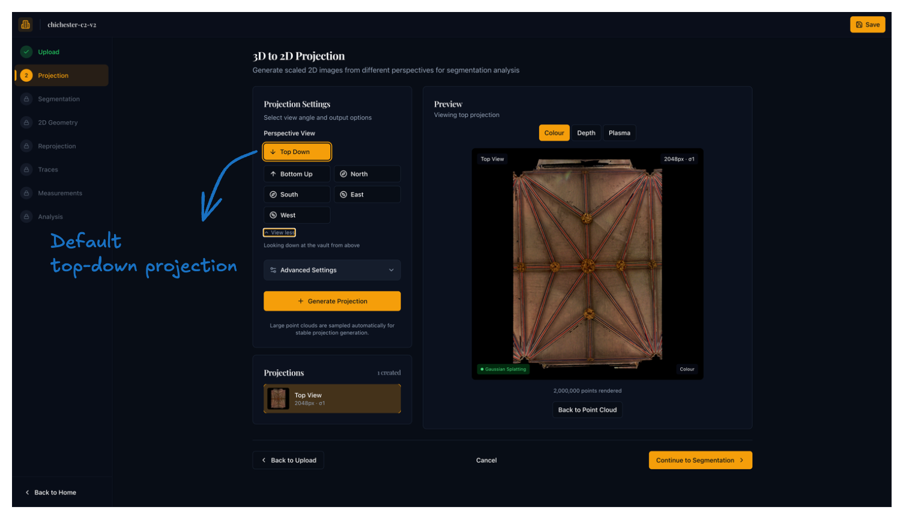

# Step 2: Generate Projection

## Purpose

Convert the loaded 3D scan into a 2D orthographic **top-down plan view** of the vault bay, ready for segmentation and geometry work.

## How projection works

The projection uses a simple form of **Gaussian splatting**, carried out as a normalised convolution:[^1]

1. Each point is dropped into the pixel directly above it in the chosen view. Every pixel keeps a running total of the colour, depth and 3D coordinates of the points that land in it, plus a count of those points.
2. The totals and the counts are both blurred with a 2D Gaussian filter. Its width in pixels is 1.5 × the **Gaussian σ** setting, clamped to 0.5–4 pixels.
3. Each pixel's blurred total is divided by its blurred count, giving a Gaussian-weighted average of the nearby points.

The result is a smooth image that fills small gaps between neighbouring scan points and gives clearer rib definition than plotting each point as a single dot. A per-pixel 3D coordinate image is saved alongside it. Step 4 uses it for aspect-ratio correction, and Step 5 uses it to place boss markers in 3D.

!!! note
    Every point in the column above a pixel contributes to its value, not just the nearest surface. This is why Step 1 expects a scan clipped to a single bay.

Large scans are downsampled to a fixed point budget before projection, so that generation time stays practical.

[^1]: Knutsson, H. and Westin, C.-F., "Normalized and Differential Convolution", *Proceedings of the IEEE Conference on Computer Vision and Pattern Recognition (CVPR)*, 1993, 515–523. This is not 3D Gaussian Splatting (Kerbl et al., 2023), which is a different, learned rendering method.

## What happens automatically

When you arrive at Step 2, the application automatically generates a **top-down plan view** of the vault bay using the default settings (Top Down perspective, standard resolution). No input is needed for this first projection. The result appears in the preview panel within a few seconds.

A confirmation prompt is shown once the image is ready:

> **Does this projection look OK?**
> - **Yes, continue** — accepts the projection and advances to Step 3.
> - **Generate a different one** — opens the settings panel so you can change the perspective, resolution, or Gaussian spread and regenerate.

For most vaults, the default top-down plan view is the correct starting point and you can proceed directly.

## Choosing a perspective

Vault Analyser supports multiple orthographic viewpoints. The choice depends on which surface you are analysing:

| Perspective | Use when |
|-------------|----------|
| **Top Down** (default) | Plan view of the bay looking down from above — the usual starting point for rib geometry |
| **Bottom Up** | Viewing the vault from below, if the plan view is unclear for your scan |
| **North / South / East / West** | Analysing a particular elevation or section if the vault is not viewed from directly below |

For most rib analysis, the **Top Down** plan view (selected by default) is the correct choice.

## Regenerating with different settings

If the default projection is not clear enough — ribs are faint, the image is blurred, or the viewpoint is wrong:

1. Click **Generate a different one** (or use the regenerate panel if you have already accepted a projection).
2. Adjust one or more settings:
   - **Perspective** — change the projection axis.
   - **Resolution / scale** — increase for finer detail at the cost of longer processing time.
   - **Gaussian spread (σ)** and **kernel size** — reduce spread for sharper edges on narrow ribs; increase it to fill gaps in sparse point clouds.
3. Click **Generate Projection** and wait for the preview to update.
4. Inspect the result and accept or regenerate again as needed.

## Interface controls

| Control | What it does |
|---------|-------------|
| Perspective selector | Chooses the projection axis |
| Resolution / scale | Sets image size and output detail |
| Gaussian σ / kernel | Controls how much each point spreads on the image plane |
| Top-down View toggle | Looks down at the vault from above (On, default) or up from below (Off) |
| Generate Projection button | Triggers the projection computation |
| Preview panel | Displays the resulting 2D image |

{ width="800" .center }

## What to check before moving on

- The main rib pattern is visible and distinct.
- Boss stone locations can be identified.
- The image is not obviously clipped, blurred, or misleading.

## Expected result

At least one accepted projection ready for segmentation in Step 3.
